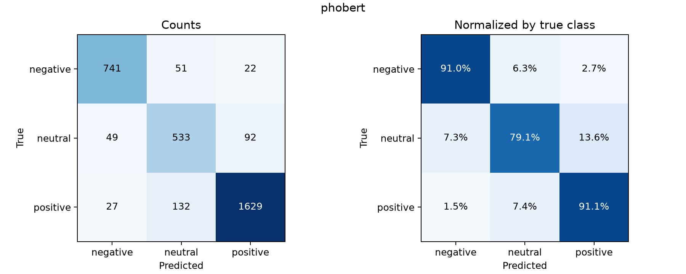
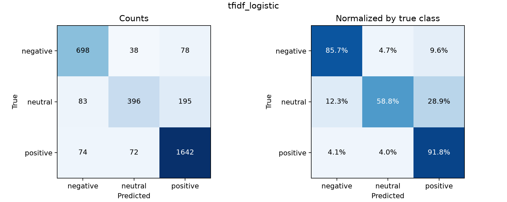
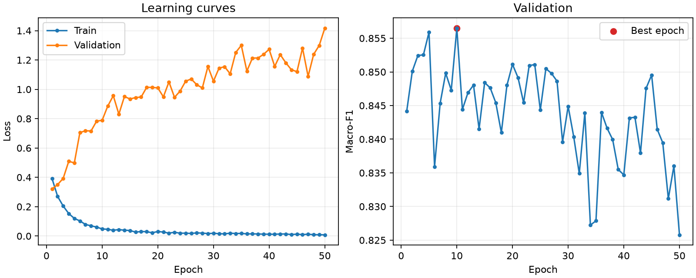

# Đánh giá mô hình phân loại cảm xúc tiếng Việt

## Thiết lập thực nghiệm

Dữ liệu được chia ở cấp văn bản với seed 42, phân tầng theo nhãn. Tập train có 26,208 văn bản, validation có 3,276 và test có 3,276. Văn bản trùng được xử lý trước khi chia. Các mô hình dùng cùng tập test và cùng nhãn 0 = tiêu cực, 1 = trung lập, 2 = tích cực. Cột label là mục tiêu huấn luyện.

PhoBERT dùng vinai/phobert-base và head Dropout → Linear. Max length = 256, overlap = 64, learning rate = 2e-05, batch hiệu dụng = 16, AdamW và weight decay = 0.01. Xác suất từng lớp của văn bản là trung bình xác suất softmax qua các chunk. Loss huấn luyện là negative log-likelihood ở cấp văn bản.

Đã hoàn tất 50 epoch. Checkpoint đánh giá là epoch 10, được chọn theo validation macro-F1 = 0.8565.

Baseline dùng TF-IDF unigram và bigram, tối đa 60.000 đặc trưng. Logistic Regression thử C ∈ {0.1, 1, 10, 100} trên validation, chọn C = 1.0 với validation macro-F1 = 0.8038. Vectorizer được fit trên train. Tập test được dùng để đánh giá cấu hình đã chọn.

## Phân bố nhãn test

| label | support |
| --- | --- |
| 0 | 814 |
| 1 | 674 |
| 2 | 1788 |

## So sánh kết quả test

| model | accuracy | precision_macro | recall_macro | f1_weighted | macro_f1 | log_loss | errors | test_size | error_rate |
| --- | --- | --- | --- | --- | --- | --- | --- | --- | --- |
| phobert | 0.8861 | 0.8620 | 0.8707 | 0.8871 | 0.8661 | 0.7512 | 373 | 3276 | 0.1139 |
| tfidf_logistic | 0.8352 | 0.8188 | 0.7878 | 0.8300 | 0.7982 | 0.4298 | 540 | 3276 | 0.1648 |

Precision và recall trong bảng là macro average. F1 weighted được cân theo số mẫu từng lớp. Macro-F1 là trung bình F1 không trọng số của ba lớp và là tiêu chí so sánh chính. Error rate là tỷ lệ dự đoán sai. Log loss đo xác suất gán cho lớp đúng, giá trị thấp hơn tốt hơn.

PhoBERT đạt accuracy 88.61% và macro-F1 0.8661. TF-IDF + Logistic Regression đạt accuracy 83.52% và macro-F1 0.7982. Chênh lệch macro-F1 (PhoBERT − baseline) là +6.79 điểm phần trăm. Kết quả này mô tả một lần chia dữ liệu, chưa có kiểm định ý nghĩa thống kê.

## Kết quả từng lớp và phân tích lỗi

### phobert

| class | precision | recall | f1-score | support |
| --- | --- | --- | --- | --- |
| negative | 0.9070 | 0.9103 | 0.9086 | 814 |
| neutral | 0.7444 | 0.7908 | 0.7669 | 674 |
| positive | 0.9346 | 0.9111 | 0.9227 | 1788 |

- Nhãn thật positive bị dự đoán thành neutral ở 132 văn bản.

- Nhãn thật neutral bị dự đoán thành positive ở 92 văn bản.

- Nhãn thật negative bị dự đoán thành neutral ở 51 văn bản.

Tổng cộng 373 văn bản sai. Danh sách đầy đủ và điểm xác suất của ba lớp nằm trong errors_phobert.csv, được sắp theo độ tự tin giảm dần. Cần đọc từng văn bản để kết luận nguyên nhân ngôn ngữ của lỗi.

Trong các dự đoán sai, 336 trường hợp có xác suất của lớp được chọn từ 0.9 trở lên. Đây là nhóm lỗi cần ưu tiên rà soát.

### tfidf_logistic

| class | precision | recall | f1-score | support |
| --- | --- | --- | --- | --- |
| negative | 0.8164 | 0.8575 | 0.8364 | 814 |
| neutral | 0.7826 | 0.5875 | 0.6712 | 674 |
| positive | 0.8574 | 0.9183 | 0.8868 | 1788 |

- Nhãn thật neutral bị dự đoán thành positive ở 195 văn bản.

- Nhãn thật neutral bị dự đoán thành negative ở 83 văn bản.

- Nhãn thật negative bị dự đoán thành positive ở 78 văn bản.

Tổng cộng 540 văn bản sai. Danh sách đầy đủ và điểm xác suất của ba lớp nằm trong errors_tfidf_logistic.csv, được sắp theo độ tự tin giảm dần. Cần đọc từng văn bản để kết luận nguyên nhân ngôn ngữ của lỗi.

Trong các dự đoán sai, 20 trường hợp có xác suất của lớp được chọn từ 0.9 trở lên. Đây là nhóm lỗi cần ưu tiên rà soát.

Log loss test của PhoBERT là 0.7512, cao hơn baseline 0.4298. Vì vậy, ưu thế về macro-F1 cần được trình bày cùng hạn chế về chất lượng xác suất dự đoán. Lỗi có độ tự tin cao bị phạt mạnh trong log loss.

## Đối chiếu dự đoán trên từng văn bản

Cả hai đúng ở 2594 văn bản, cả hai sai ở 231 văn bản. PhoBERT đúng và baseline sai ở 309 văn bản, baseline đúng và PhoBERT sai ở 142 văn bản. Chi tiết nằm trong paired_predictions.csv.

## Learning curves

Ở epoch cuối, train loss = 0.0084, validation loss = 1.4171 và validation macro-F1 = 0.8258. Best checkpoint được chọn bằng validation.

Khi train loss giảm trong khi validation loss tăng, đó là dấu hiệu overfitting. Macro-F1 validation tốt nhất ở epoch 10, với giá trị 0.8565, so với 0.8258 ở epoch 50. Báo cáo test sử dụng checkpoint tốt nhất theo validation.

## Giới hạn kết quả

Thực nghiệm sử dụng tập sampled tương ứng với checkpoint. Nhãn đầu vào được kế thừa từ dataset đã chuẩn bị. Chưa thực hiện đánh giá riêng theo miền dữ liệu hoặc kiểm tra độc lập chất lượng nhãn. Hash CSV, chỉ số dòng của từng tập và cấu hình lựa chọn được lưu trong evaluation_manifest.json và các tệp *_indices.csv để tái lập kết quả.
